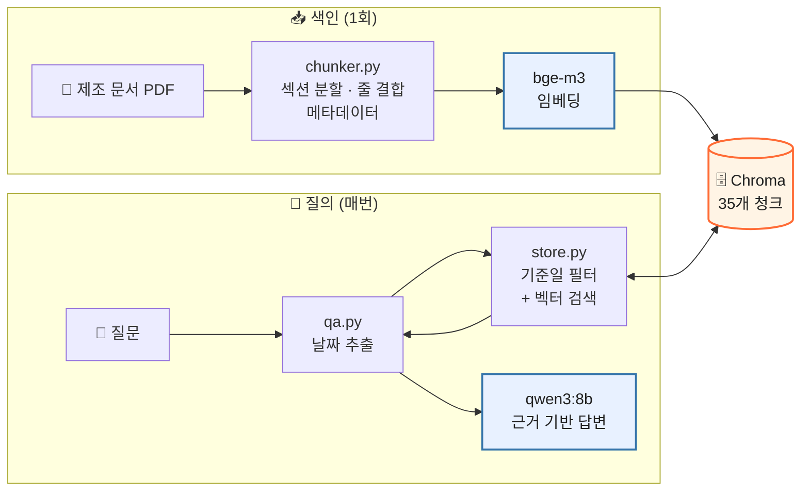

<div align="center">

# 🏭 제조 문서 RAG

**질문한 날짜에 유효했던 문서만 근거로 답하는 로컬 RAG 시스템**

제조 현장 PDF를 벡터DB로 만들고, 개정·폐기 이력까지 구분해 검색합니다.<br/>
PDF 파싱부터 임베딩, 검색, 답변 생성까지 외부 API 없이 모두 로컬에서 동작합니다.

<br/>


<br/>

| 📄 문서 | 🧩 청크 | 📐 임베딩 | 🎯 기준일 필터 |
| :---: | :---: | :---: | :---: |
| **9종** | **35개** | **1024차원** | **개정별 정확히 1개** |

</div>

<br/>

> [!NOTE]
> **진행 상황** — 청킹 · 벡터DB 저장 · 기준일 필터 검색 ✅ 완료 / LLM 답변 평가 🔄 진행 중

<br/>

## 📑 목차

- [🎯 왜 단순한 RAG로는 안 되나](#-왜-단순한-rag로는-안-되나)
- [🗺️ 구성](#️-구성)
- [🚀 빠른 시작](#-빠른-시작)
- [💡 핵심 설계](#-핵심-설계)
- [📊 검색 결과](#-검색-결과)
- [🤖 답변 생성](#-답변-생성)
- [🛠️ 트러블슈팅](#️-트러블슈팅)
- [🧭 다음 단계](#-다음-단계)

<br/>

## 🎯 왜 단순한 RAG로는 안 되나

"PDF를 일정 길이로 잘라 벡터 검색"하는 방식은 실제 제조 문서 앞에서 이렇게 무너집니다.

| | 함정 | 단순 RAG의 실패 | 이 프로젝트의 해결 |
| :---: | --- | --- | --- |
| 📅 | **개정 이력**<br/><sub>QC-210 Rev.2 폐기 / Rev.3 현행</sub> | 폐기된 ±0.030 mm와 현행 ±0.020 mm가 함께 검색됨 | 유효 기간 메타데이터 + 기준일 필터 |
| 👯 | **유사 문서**<br/><sub>VH-20 vs VH-30 검사기준</sub> | 다른 제품의 기준을 인용 | 청크 머리말 + 프롬프트 규칙 |
| 📝 | **기록 문서**<br/><sub>사건·실적</sub> | 기록일(8/21)이 사건일(8/20)보다 늦어 필터에서 빠짐 | 기록 문서는 시점 필터 미적용 |
| ❓ | **없는 정보**<br/><sub>VH-40 사양, C-201 알람</sub> | 일반 지식으로 지어냄 | 근거 없음 응답 규칙 |

<br/>

## 🗺️ 구성



| 단계 | 역할 | 담당 |
| :---: | --- | --- |
| **R**etrieval | 기준일에 유효한 문서 중 질문과 가까운 청크 찾기 | `store.search()` |
| **A**ugmented | 검색된 청크를 출처와 함께 프롬프트에 넣기 | `qa.ask()` |
| **G**eneration | 근거만으로 답변 작성 | `ollama.chat()` |

<details>
<summary><b>📁 프로젝트 구조</b></summary>

<br/>

```
smartfactory-rag-agent/
├── app/
│   └── rag/
│       ├── chunker.py   # PDF → 섹션 단위 청크 + 메타데이터
│       ├── store.py     # 임베딩, Chroma 저장, 기준일 필터 검색
│       └── qa.py        # 검색 결과를 근거로 LLM 답변 생성
├── data/
│   ├── manuals/         # 제조 문서 PDF (가상 교육 데이터)
│   └── chroma/          # 벡터DB (자동 생성, Git 제외)
└── pyproject.toml
```

</details>

<details>
<summary><b>🧰 기술 스택과 선택 이유</b></summary>

<br/>

| 구분 | 구성 | 선택 이유 |
| --- | --- | --- |
| 환경 | WSL2, uv, Python 3.12 | 가상환경과 의존성 잠금으로 재현성 확보 |
| PDF 파싱 | PyMuPDF | 글꼴 크기와 좌표까지 추출 |
| 임베딩 | bge-m3 (Ollama) | 한국어 검색 성능, PyTorch 설치 불필요 |
| 벡터DB | Chroma | 로컬 파일 저장, 메타데이터 범위 필터 |
| LLM | qwen3:8b (Ollama) | 한국어 응답 품질, 추론 모드 지원 |

</details>

<br/>

## 🚀 빠른 시작

```bash
# 1. Python 환경
curl -LsSf https://astral.sh/uv/install.sh | sh && source ~/.bashrc
git clone https://github.com/<your-id>/smartfactory-rag-agent.git
cd smartfactory-rag-agent && uv sync

# 2. Ollama (WSL 안에 설치, 서비스로 자동 실행)
sudo apt install -y zstd
curl -fsSL https://ollama.com/install.sh | sh
ollama pull bge-m3 && ollama pull qwen3:8b

# 3. 실행
uv run python -m app.rag.store        # 벡터DB 생성 + 검색 비교
uv run python -m app.rag.qa           # 대화형 질의응답
uv run python -m app.rag.qa --think   # 추론 모드 (계산 질문 권장)
```

> [!TIP]
> 모든 명령은 **프로젝트 루트에서 `-m` 방식**으로 실행하세요. 파일 경로로 직접 실행하면 `ModuleNotFoundError: No module named 'app'`이 납니다.

<br/>

## 💡 핵심 설계

### 1️⃣ 글꼴 크기로 문서 구조 인식

글자만 뽑으면 소제목과 본문을 구분할 수 없어 길이로 자를 수밖에 없고, 수치와 단위가 다른 청크로 갈라집니다. PDF를 직접 관찰해 보니 **글꼴 크기가 곧 문서 구조**였습니다.

| 크기 | 역할 | 처리 |
| :---: | --- | --- |
| `21.0` **Bold** | 문서 제목 | 📌 메타데이터 |
| `10.5` <sub>첫 소제목 앞</sub> | 문서 ID · 개정 · 발효일 | 📌 메타데이터 |
| `12.0` **Bold** | 소제목 | ✂️ **청크 경계** |
| `10.5` | 본문 | 📝 청크 내용 |
| `10.0` / `8.0` | 머리말 / 바닥글 | 🗑️ 버림 |

### 2️⃣ 한글 줄바꿈 처리

한글 PDF는 단어 중간에서 줄이 바뀌고(`마이크` ↵ `로미터`), 띄어쓰기도 지워져 **줄 끝 공백으로는 구분이 불가능**합니다. 대신 각 줄의 **오른쪽 끝 좌표(x1)**로 판정합니다.

| 줄 | x1 | 판정 |
| --- | ---: | --- |
| `...내경 마이크` | 547.0 | 🔗 자동 줄바꿈 → 이어 붙임 |
| `...경계값을 포함합니다.` | 534.8 | 🔗 자동 줄바꿈 <sub>(다음 단어 `20.025`가 길어 통째로 넘어감)</sub> |
| `SOP-110 ... / 제조팀` | 329.2 | ↵ 항목 끝 → 줄바꿈 유지 |

> [!IMPORTANT]
> **기준값은 코드에 적지 않고 계산합니다.** 오른쪽 끝(554.8)을 **문서 전체**에서 구해, 짧은 목록만 있는 쪽에서도 오판하지 않게 했습니다. 허용 오차 30은 실제 좌표를 출력해 정했습니다. 534.8 줄이 기준선 524.8을 겨우 10 차이로 통과하기 때문입니다.

### 3️⃣ 문서 유효 기간 메타데이터

폐기본과 현행본은 내용이 거의 같아 **벡터 검색으로는 구분이 안 됩니다.** LLM에게 맡기는 대신, 검색 단계에서 기준일에 유효한 문서만 남겨 **LLM이 폐기본을 아예 보지 못하게** 했습니다.

```python
where = {"$and": [
    {"valid_from": {"$lte": asof}},  # 유효 시작일 <= 기준일
    {"valid_to":   {"$gt":  asof}},  # 기준일 < 유효 종료일
]}
```

| 문서 종류 | 날짜의 의미 | 유효 기간 |
| --- | --- | --- |
| 📘 발효 문서 <sub>기준·절차</sub> | 이날부터 따라야 하는 규칙 | 발효일 ~ 폐기일 |
| 📝 기록 문서 <sub>사건·실적</sub> | 이미 일어난 사실을 적은 날 | 항상 유효 |

- 날짜는 `20260815` 같은 **정수**로 저장 → Chroma의 범위 비교는 숫자에만 동작
- 종료일 당일은 무효(`<`) → **어느 날짜든 정확히 한 개의 개정만 유효**

| 기준일 | 유효한 QC-210 |
| :---: | :---: |
| 2026-08-14 | Rev.2 |
| 2026-08-15 | Rev.3 |

### 4️⃣ 청크 머리말

5쪽 "내경 합격 기준" 본문에는 `VH-20`이 **한 번도 나오지 않습니다**(제목에만 있음). 문서 맥락을 청크 앞에 붙여 함께 임베딩합니다.

```diff
- [QC-210 Rev.2 | VH-20 검사기준 · 과거본 | 폐기]
+ [QC-210 Rev.2 | VH-20 검사기준 · 과거본 | 발효 2026-06-01 / 폐기 2026-08-15]
  내경과 샘플링
  내경 규격은 20.000 ± 0.030 mm이며 ...
```

> [!WARNING]
> 처음엔 머리말에 `폐기` 같은 **판단**을 넣었습니다. 하지만 이건 "오늘 기준"이라, 8월 10일 질문에서 당시 현행이던 Rev.2를 LLM이 거부할 수 있습니다. 머리말에는 **날짜 같은 사실만** 적고, 판단은 기준일을 아는 검색 단계에 맡겼습니다.

<br/>

## 📊 검색 결과

질문 **"VH-20 내경 합격 범위는?"** · 숫자는 코사인 거리 <sub>(작을수록 가까움)</sub>

| 조건 | 🥇 1위 | 🥈 2위 | 🥉 3위 |
| --- | --- | --- | --- |
| 필터 없음 | `0.234` Rev.3 ✅ | `0.290` VH-30 ⚠️ | `0.305` **Rev.2 폐기** ❌ |
| 기준일 2026-08-10 | `0.305` Rev.2 ✅ | `0.393` Rev.2 ✅ | `0.481` SOP-110 |
| 기준일 2026-11-14 | `0.234` Rev.3 ✅ | `0.290` VH-30 ⚠️ | `0.422` Rev.3 ✅ |

**읽어낸 것**

- ❌ **필터 없이는 폐기본이 섞입니다** — Rev.2가 0.305로 현행본 바로 뒤를 따라옵니다
- ✅ **기준일 필터가 의도대로 동작합니다** — 8월 10일엔 Rev.2만, 오늘은 Rev.3만
- 🔍 **필터는 거리를 바꾸지 않고 후보만 지웁니다** — Rev.2는 어느 조건에서든 0.305
- ⚠️ **유사 문서 구분은 아슬아슬합니다** — VH-30이 정답과 0.056 차이로 2위. 프롬프트 규칙으로 한 번 더 막습니다

<br/>

## 🤖 답변 생성

```
질문 → 📅 날짜 추출 → 🔍 그날 유효한 문서만 검색 (k=5) → 📎 출처와 함께 프롬프트 구성 → 🤖 답변
```

| 설정 | 값 | 이유 |
| --- | --- | --- |
| 날짜 추출 | `2026-08-10`, `8월 10일` | 없으면 오늘 날짜 |
| `num_ctx` | 8192 | Ollama 기본값이 작아 근거가 잘림 |
| `temperature` | 0 | 같은 질문에 같은 답 |
| `think` | 선택 | 계산 질문은 추론 후 답변 |

<details>
<summary><b>📜 시스템 프롬프트 핵심 규칙</b></summary>

<br/>

1. 근거 문서에 있는 내용만으로 답한다. 없으면 "제공된 문서에서 근거를 찾을 수 없습니다"라고 답한다.
2. 근거는 기준일에 유효한 문서만 골라 둔 것이므로, 폐기일이 적혀 있어도 기준일이 그 전이면 사용한다.
3. 제품·설비·로트가 다른 문서의 수치를 서로 대신 쓰지 않는다.
4. 수치는 문서 그대로 단위와 함께 옮기고, 문장마다 `[문서 ID, Rev.N, N쪽]` 출처를 붙인다.

</details>

### 평가 질문 <sub>🔄 진행 중</sub>

| 질문 | 시험하는 것 | 기대 답변 | 결과 |
| --- | --- | --- | :---: |
| VH-20 내경 합격 범위는? | 현행 기준 | 19.980~20.020 mm | ⏳ |
| 2026-08-10 기준 VH-20 정기 검사 주기는? | 개정 이력 | 2시간마다 3개 | ⏳ |
| VH-30 내경 규격은? | 유사 문서 구분 | 30.000 ± 0.025 mm | ⏳ |
| VH-40 내경 규격은? | 없는 정보 | 근거 없음 응답 | ⏳ |

<br/>

## 🛠️ 트러블슈팅

<details>
<summary><b>개발 중 만난 오류 5건과 해결 과정 펼치기</b></summary>

<br/>

| 증상 | 원인 | 해결 |
| --- | --- | --- |
| `KeyError: 'lines'` | 딕셔너리를 만든 곳과 읽는 곳의 키 이름 불일치 | 트레이스백을 아래에서 위로 읽어 "그 딕셔너리는 어디서 만들어졌나"로 추적 |
| `cannot unpack non-iterable NoneType` | `return` 들여쓰기 오류로 함수가 `None` 반환 | `return`을 함수 본문 깊이로 이동 |
| 청크가 35개가 아닌 **3개** | `return chunks`가 `for` 안에 있어 첫 쪽만 처리 | `return`을 반복문 밖으로 이동 |
| `ModuleNotFoundError: 'app'` | 파일 경로로 실행하면 프로젝트 루트가 모듈 경로에 없음 | `uv run python -m app.rag.store`로 실행 |
| `UnicodeEncodeError: surrogates` | 한글 입력 중 백스페이스로 3바이트 중 일부만 지워짐 | 입력 직후 깨진 바이트 제거<br/>`q.encode("utf-8", "surrogateescape").decode("utf-8", "ignore")` |

</details>

<br/>


---

<div align="center">
<sub>📌 문서 데이터는 실습용 <b>가상 교육 데이터</b>이며 실제 생산·설비 운전에 사용할 수 없습니다.<br/>
벡터DB(<code>data/chroma/</code>)는 <code>uv run python -m app.rag.store</code>로 다시 만들 수 있어 Git에 포함하지 않습니다.</sub>
</div>
